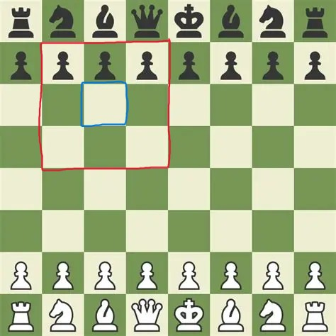
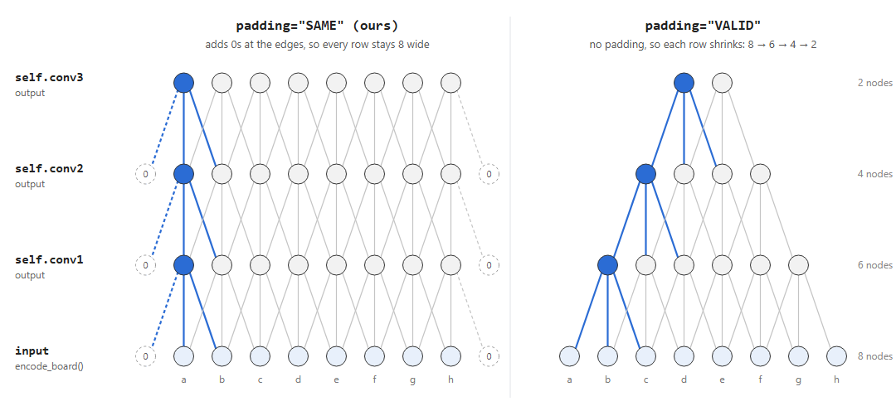
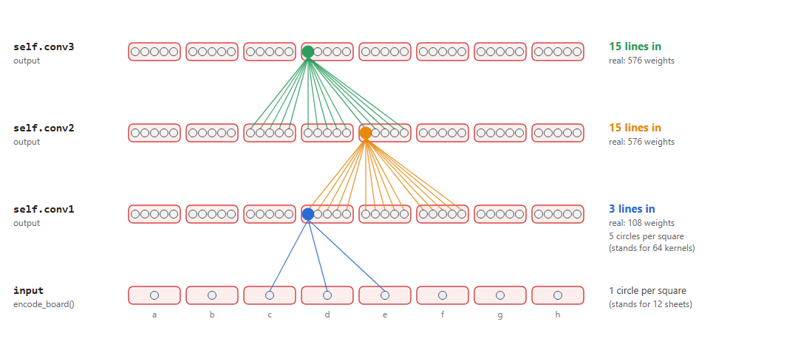

# Convolution: the kernel

```python
self.conv1 = nnx.Conv(12, channels, kernel_size=(3, 3), strides=1, padding="SAME", rngs=rngs)
```

`kernel_size=(3, 3)` is the **kernel**: a small 3x3 window that looks at one
square and its 8 neighbours.

## The window



- **Blue square (c6):** the square we're working out a number for.
- **Red box (b7 to d5):** what the kernel looks at to do it: c6 plus its 8
  neighbours.

## The weights

Each kernel has **3 x 3 x 12 = 108 weights**, and conv1 has 64 kernels.
They're all stored in one array:

```
conv1.kernel   shape (3, 3, 12, 64)
                      │  │   │   └─ which kernel (64 of them, set by channels=64)
                      │  │   └───── which piece sheet (12)
                      └──┴───────── where in the 3×3 window (9 spots)
```

The 64 kernels come from `channels=64`, a number we pick. It has nothing to
do with the 64 squares on the board.

**`conv1.kernel`** is the entire array of kernels, and each **kernel** is one
pattern detector of **108 weights**:

```
conv1.kernel
├── kernel 0   (108 weights)   e.g. "attacked by black pawns?"
├── kernel 1   (108 weights)   e.g. "knight nearby?"
├── kernel 2   (108 weights)
│   ...
└── kernel 63  (108 weights)
```

64 kernels x 108 weights = **6,912 weights**.

### One kernel, every stop

A kernel only has 108 weights, but it still covers the whole board: it
**reuses the same 108 weights at every stop**. It carries them to the next
stop and multiplies them against the board data there. Different data under
the window gives a different opinion, using the same 108 weights each time.

Every kernel visits every stop. They don't split the board between them.

## Stride

`strides=1` is how many squares the kernel **jumps** each time it moves, both
across and down. Each place it stops is a **position**, and each position
gives one output number per kernel. The grid of results is the **output size**
(also called the **feature map** size).

### Stride 1 (ours)

The kernel stops on every square: a8, b8, c8 ... h8, then the next row down,
and so on.

```
8 across x 8 down = 64 positions  ->  output is 8x8
```

### Stride 2

The kernel skips every other square, across **and** down:

```
X . X . X . X .
. . . . . . . .
X . X . X . X .
. . . . . . . .
X . X . X . X .
. . . . . . . .
X . X . X . X .
. . . . . . . .

4 across x 4 down = 16 positions  ->  output is 4x4
```

Strides can also be set separately per direction, e.g. `strides=(1, 2)` would
step 1 down but 2 across (8 x 4 = 32 positions). A plain `strides=2` applies
to both.

### Why stride 1

Stride 2 throws away detail: the board shrinks to 4x4 and there's no longer a
result for every square. In chess the exact square matters, so we keep
stride 1 and the board stays 8x8 through every conv layer.

## Padding

`padding="SAME"` decides what happens at the **edge of the board**, where part
of the 3x3 window hangs off the side.



### `padding="SAME"` (ours)

The dashed **`0`** circles are **padding**: fake empty squares added off the
edge of the board.

The blue node on the a-file still gets its 3 connections, because one of them
goes to a padding `0`. So every square gets an output, and every row stays
**8 wide**.

### `padding="VALID"`

No padding. A node can only exist where all 3 of its connections land on real
squares, so each layer loses one node from each side:

```
8 -> 6 -> 4 -> 2
```

After three conv layers only 2 nodes would be left, and the a, b, g and h
files would be gone.

### Why SAME

Edge squares matter in chess: rooks start in the corners, kings castle to the
side. `"SAME"` keeps all 64 squares through every conv layer.

## Layers at full size

Each line is one weight. The **lines going into a circle** are the kernel's
weights: 3 in the diagram, but at full size:

| Row | Lines into each circle |
|---|---|
| `self.conv1` output | 3 x 3 x 12 = **108** |
| `self.conv2` output | 3 x 3 x 64 = **576** |
| `self.conv3` output | 3 x 3 x 64 = **576** |

conv2 and conv3 have more lines per circle because they don't read the board,
they read the layer below. Each square there holds **64 kernel opinions**
(one per kernel) instead of **12 piece types**:

- conv1: 9 squares x 12 piece types = **108**
- conv2 / conv3: 9 squares x 64 kernel opinions = **576**

Scaled down, it looks like this (1 circle stands for 12 piece types, 5 circles for
64 kernels, so the lines keep roughly the real 1 : 5 ratio):



Each coloured node only connects to the 3 squares below it, but from conv2 on,
each of those squares has 5 circles (really 64), so there are far more lines.

### Reading the diagram

- **Each red square** is one place where the window stopped. With stride 1
  (ours) the window stops on every chess square, so each red square lines up
  with one square on the board.
- **Each circle** is one kernel's **final opinion** on that **red square**: a single
  number, worked out from the 108 lines going into it.
- **Each line** is one weight. A kernel's **108 weights go into 1 circle**:
  that kernel's opinion.
