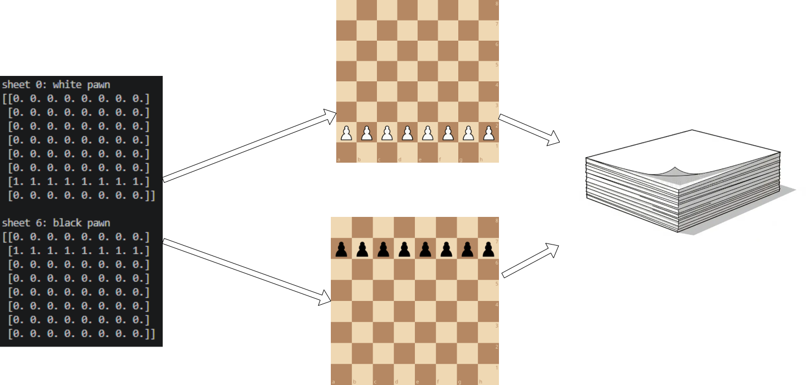

# Board encoding

A network only understands numbers, so `encode_board()` in
[`encoding.py`](../encoding.py) turns a chess position into an array:

```python
x = encode_board(chess.Board())   # shape (8, 8, 12), on the CPU
x = encode_fen(fen)               # same, from a FEN string (e.g. Lichess data)
x = encode_batch(boards)          # many boards: (batch, 8, 8, 12), uploaded to the GPU
```

## 12 input feature maps

The board is split into **12 grids of 8x8**, one per piece type and colour.
Each grid has a `1` where that piece is and `0` everywhere else.



Left to right: the printed maps for white pawns (map 0) and black pawns
(map 6), what those `1`s mean on the board, and all 12 maps stacked into one
array. The network gets the whole stack at once.

| Map | Piece | Map | Piece |
|---|---|---|---|
| 0 | white pawn | 6 | black pawn |
| 1 | white knight | 7 | black knight |
| 2 | white bishop | 8 | black bishop |
| 3 | white rook | 9 | black rook |
| 4 | white queen | 10 | black queen |
| 5 | white king | 11 | black king |

In the convolution paper's terms ([Dumoulin & Visin, 2016][paper]) these are
the network's **input feature maps**, also called **input channels**. The
paper's figures usually draw a single feature map; we have 12 stacked together.

## The shape: `(8, 8, 12)`

```
planes[row, col, map]
       │    │    └─ which piece type (0-11)
       │    └────── file: 0 = a ... 7 = h
       └─────────── rank: 0 = rank 1 ... 7 = rank 8
```

For example, `planes[1, 4, 0]` is the white-pawn map on e2: `1.0` in the
starting position.

The network takes boards in batches, which adds a dimension at the front:
`(batch, 8, 8, 12)`. For one board: `encode_board(board)[None]`.

## Why one map per piece?

A single grid with pawn = 1, knight = 2 ... would make the network treat a
knight as "two pawns". Separate maps keep each piece type independent. This is
called **one-hot encoding**: each square has at most one `1` across the 12
maps, and an empty square is all `0`s.

## How the code works

1. Start with an `(8, 8, 12)` array of zeros.
2. For every piece on the board, work out its rank (row), file (column) and
   map (`piece_type - 1`, plus 6 for black).
3. Put a `1` there.
4. Return it as a NumPy array, still on the CPU.

The array is built with NumPy because NumPy arrays can be changed in place;
JAX arrays can't.

## Batching before the GPU

Copying data to the GPU has a fixed cost each time, so copying boards one at a
time is slow. `encode_batch` encodes every board on the CPU first, stacks them,
then uploads the whole batch to the GPU in **one** copy:

```
1000 boards, one-by-one upload:  ~420 ms
1000 boards, encode_batch:        ~25 ms
```

[paper]: https://arxiv.org/abs/1603.07285
